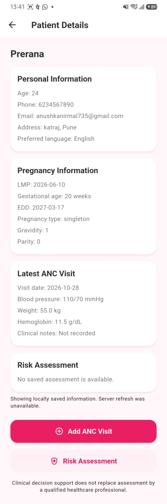
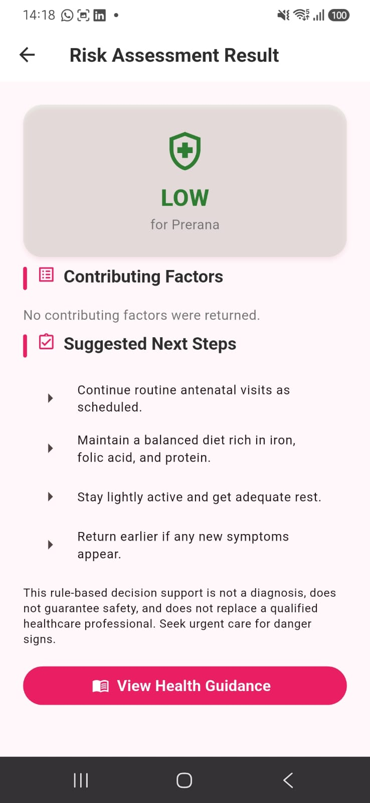
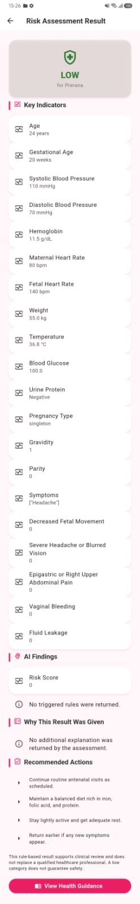
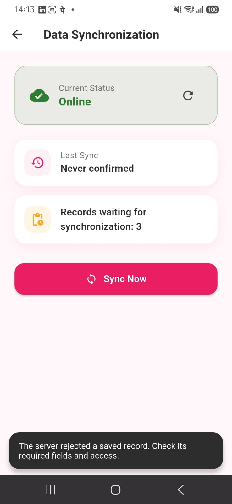

<div align="center">

# 🌸 PregAI Rural

### AI-Assisted Maternal Healthcare & Personalized Nutrition Support for Rural India

**Empowering safer pregnancies through accessible digital support, early risk awareness, and locally relevant nutrition guidance.**


**SEVA FIRST INNOVATION CHALLENGE | MAHARASHTRA ZONE**

</div>

---

# 💡 1. THE PROBLEM WE WANT TO SOLVE

Pregnancy is one of the most important stages in a woman's life. Yet, many women in rural and underserved communities face challenges in accessing timely maternal-health information and practical nutrition guidance.

Some common challenges include:

- Limited access to healthcare information and services.
- Difficulty recognizing when pregnancy-related concerns need professional attention.
- Lack of personalized nutrition guidance.
- Dietary recommendations that may not consider locally available foods.
- Language, awareness, and accessibility barriers.
- Difficulty maintaining continuity of health-related information.

These challenges highlight the need for accessible digital support that complements existing maternal healthcare services.

# 🌸 2. OUR SOLUTION — PREGAI RURAL

**PregAI Rural** is a digital maternal-health support platform designed to make pregnancy-related awareness and nutrition guidance more accessible to rural communities.

Our application brings two important aspects of maternal wellness together:

🩺 **Pregnancy Risk Awareness**

The application collects user-provided pregnancy information and presents a risk-result screen using its current rule-based assessment logic.

🥗 **Personalized Nutrition Support**

The application allows users to select dietary preferences and locally available foods, then generates educational meal suggestions based on those preferences.

🤝 **Community Healthcare Support**

The platform is designed with the potential to complement ASHA workers and other frontline healthcare professionals by making basic information easier to access.

Our vision is simple:

**A healthier pregnancy should not depend on where a woman lives.**

# ✨ 3. KEY FEATURES

| Feature | Description |
|---|---|
| Pregnancy Risk Assessment | Presents risk-related results based on information entered by the user and the application's rule-based logic. |
| Personalized Nutrition | Generates educational meal suggestions based on dietary preferences. |
| Local Food Preferences | Considers food options selected by users as locally available. |
| Vegetarian Food Filtering | Filters eggs, fish, and chicken from suggestions for vegetarian profiles. |
| Preference Storage | Saves nutrition preferences for use in the meal-planning workflow. |
| Integrated User Journey | Connects pregnancy risk results with nutrition preferences and meal suggestions. |
| Cross-platform Foundation | Built using Flutter for a flexible application experience. |

# 🚀 4. HOW PREGAI RURAL WORKS

The application follows a simple user journey:

1. The user opens the PregAI Rural application.
2. The user enters the pregnancy information requested by the application.
3. The application presents a risk-assessment result.
4. The user navigates to the nutrition preferences section.
5. The user selects dietary preferences and available food options.
6. The application saves the selected preferences.
7. The nutrition engine generates educational meal suggestions based on the saved choices.

### Our Workflow

```text
       PREGNANT WOMAN
              |
              v
     ENTER PREGNANCY DETAILS
              |
              v
    RULE-BASED RISK ASSESSMENT
              |
              v
       RISK RESULT SCREEN
              |
              v
     SELECT NUTRITION PREFERENCES
              |
              v
      SELECT AVAILABLE FOODS
              |
              v
      SAVE USER PREFERENCES
              |
              v
    PERSONALIZED MEAL SUGGESTIONS


## 📱 APPLICATION SCREENSHOTS

### 1. Patient Details Dashboard


### 2. Pregnancy Risk Assessment Result


### 3. Detailed Risk Indicators


### 4. Data Synchronization

